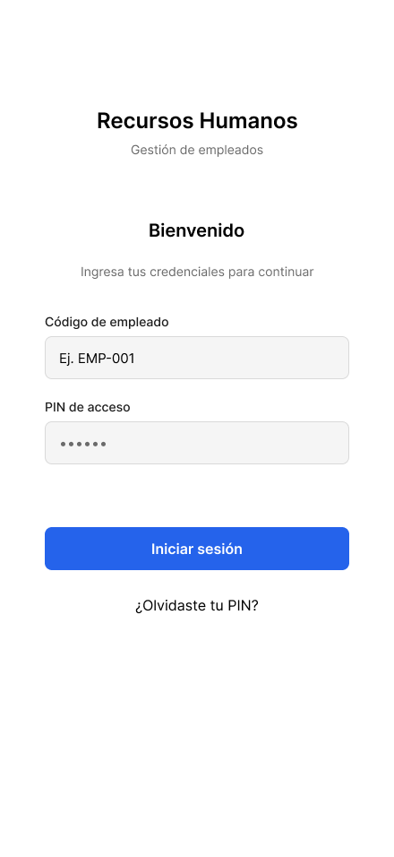
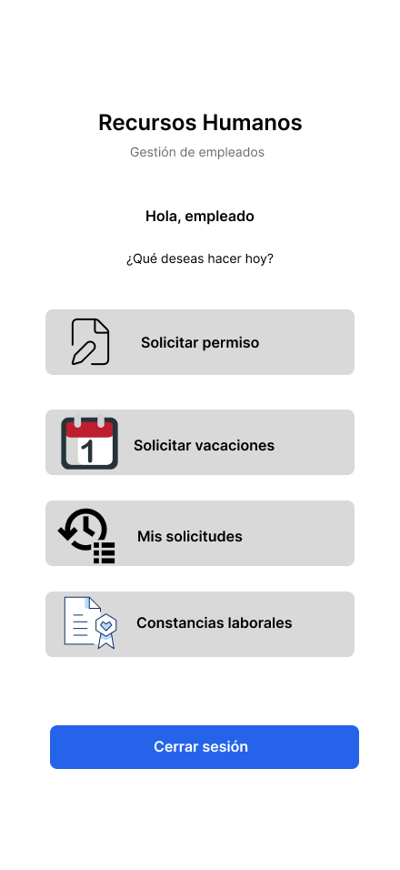
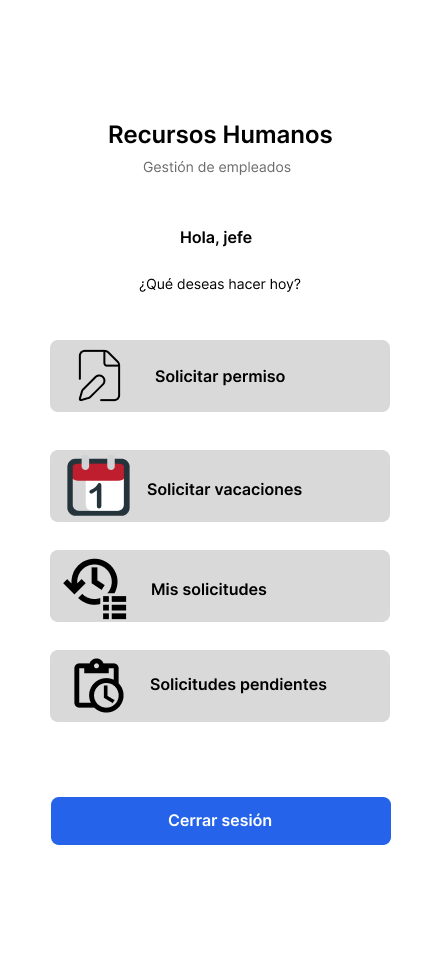
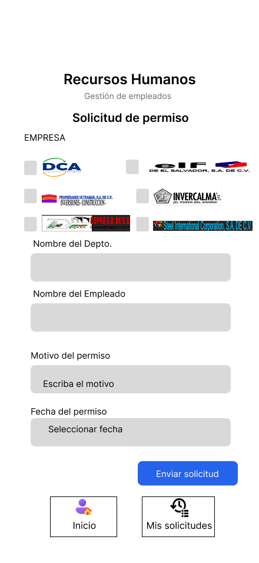
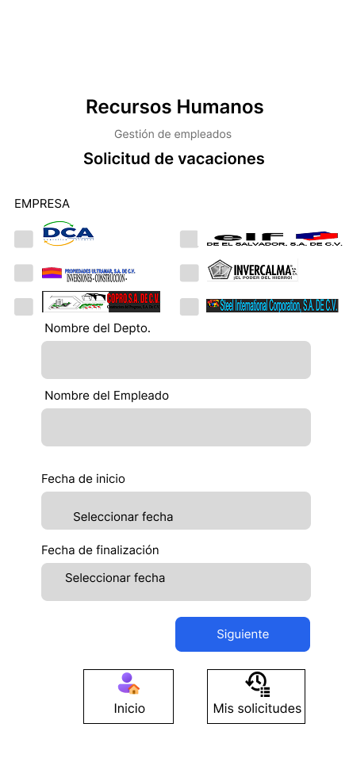
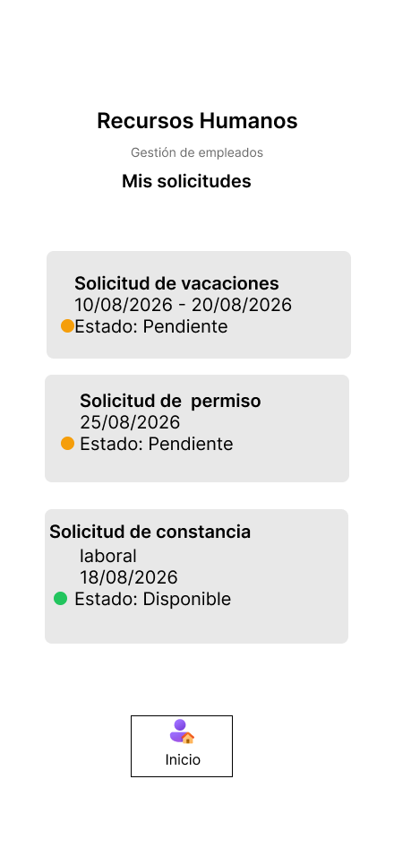
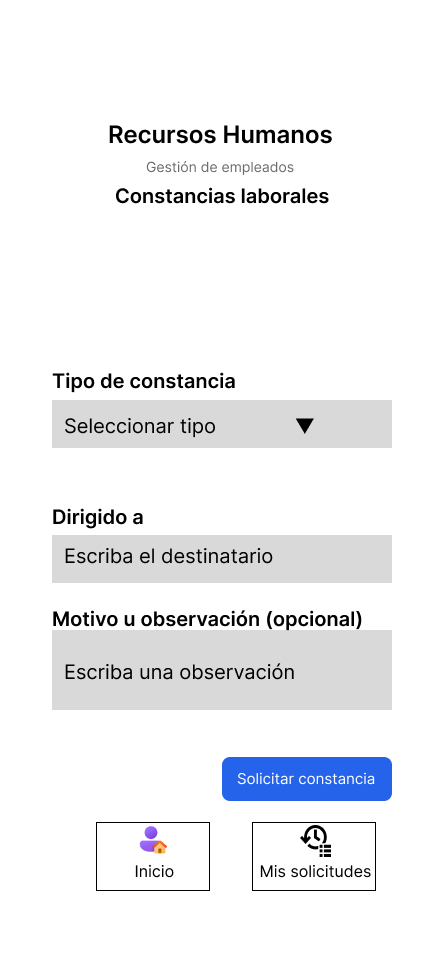
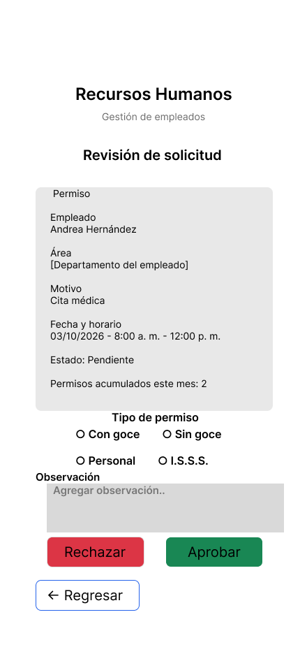

# Sistema de Gestión de Recursos Humanos

Sistema multiplataforma (web y móvil) desarrollado para la **gestión de procesos de Recursos Humanos**, orientado a centralizar solicitudes, vacaciones, permisos, constancias laborales, aprobaciones y consultas relacionadas con los empleados de las empresas contempladas en el proyecto.

El sistema contempla las siguientes **seis empresas**:

- Didelco
- Steel
- EFL
- DCA
- Copro
- Propultran

---

## Objetivo del proyecto

Desarrollar una plataforma web que permita digitalizar y centralizar diferentes procesos de Recursos Humanos, facilitando la interacción entre empleados, jefes inmediatos y personal administrativo.

La aplicación permite gestionar solicitudes, consultar información de empleados, controlar procesos de aprobación y visualizar información relevante mediante un dashboard.

---

## Funcionalidades principales

- Inicio de sesión de usuarios.
- Manejo de diferentes roles.
- Control de acceso según el rol del usuario.
- Gestión de solicitudes de empleados.
- Solicitudes de permisos.
- Solicitudes de vacaciones.
- Solicitudes de constancias laborales.
- Flujo de aprobación y rechazo de solicitudes.
- Registro de observaciones durante los procesos de aprobación.
- Consulta de información de empleados.
- Dashboard con indicadores y gráficas.
- Generación de constancias en formato PDF.
- Generación de códigos QR.
- Exportación de información.
- Integración con Firebase.
- Integración con una API REST.
- Validación y manejo de errores.

---

## Tecnologías utilizadas

- **Next.js**
- **React**
- **TypeScript**
- **Tailwind CSS**
- **Firebase Authentication**
- **Cloud Firestore**
- **Firebase Storage**
- **Next.js Route Handlers**
- **API REST**
- **Fetch API**
- **Recharts**
- **PDF-Lib**
- **QRCode**
- **Lucide React**
- **Git**
- **GitHub**
- **Vercel**

---

## Roles del sistema

El sistema contempla diferentes niveles de acceso de acuerdo con las responsabilidades de cada usuario.

### Admin TI

Encargado de funciones administrativas relacionadas con usuarios y acceso al sistema.

### Gerente

Posee acceso administrativo y participa en determinados procesos de aprobación.

### Analista de Nómina

Participa en procesos relacionados con solicitudes, validaciones y gestión administrativa.

### Asistente de Planilla

Cuenta con acceso a información necesaria para procesos administrativos y de empleados.

### Jefe Inmediato

Puede consultar las solicitudes correspondientes y participar en los procesos de aprobación o rechazo.

### Empleado

Puede ingresar al sistema, realizar solicitudes y consultar el estado de sus procesos.

---

## Arquitectura del proyecto

El proyecto utiliza la arquitectura proporcionada por **Next.js**, separando las principales responsabilidades del sistema.

```text
app/
├── api/
│   └── solicitudes/
├── dashboard/
├── solicitudes/
├── reportes/
└── ...

components/
context/
lib/
mocks/
services/
types/
```

La aplicación separa:

- **Interfaz de usuario:** páginas y componentes desarrollados con React y Next.js.
- **Lógica de aplicación:** contextos, validaciones y servicios.
- **Acceso a datos:** servicios de Firebase, Firestore y API REST.
- **Datos en la nube:** Cloud Firestore y Firebase Storage, compartidos con la app móvil.

---

## Firebase

El proyecto utiliza **Firebase Authentication** para la autenticación de usuarios y **Cloud Firestore** para el manejo de información utilizada por diferentes módulos del sistema.

La configuración de Firebase utiliza variables de entorno almacenadas localmente en el archivo:

```text
.env.local
```

Variables utilizadas:

```text
NEXT_PUBLIC_FIREBASE_API_KEY
NEXT_PUBLIC_FIREBASE_AUTH_DOMAIN
NEXT_PUBLIC_FIREBASE_PROJECT_ID
NEXT_PUBLIC_FIREBASE_STORAGE_BUCKET
NEXT_PUBLIC_FIREBASE_MESSAGING_SENDER_ID
NEXT_PUBLIC_FIREBASE_APP_ID
```

Por seguridad, los valores reales de estas variables **no se almacenan en este README**.

La web y la app móvil comparten el mismo proyecto de Firebase:

- **Authentication:** inicio de sesión con correo y contraseña y con Google, tanto en la web como en la app.
- **Cloud Firestore:** las colecciones `usuarios`, `permisos`, `vacaciones` y `constancias` son las mismas para la web y la app, así que lo que se registra en una se ve en la otra en tiempo real.
- **Storage:** fotos de perfil en `fotos_perfil/{uid}.jpg`, que se pueden subir desde la web o desde la app.
- **Reglas de seguridad:** están en `firestore.rules` y no están en modo de prueba.

---

# API REST

El proyecto incorpora una **API REST para solicitudes**, implementada con los Route Handlers de Next.js. En la Entrega Final la API trabaja con los **datos reales de Cloud Firestore** (colecciones `permisos` y `vacaciones`, las mismas de la app móvil).

## Seguridad

La API no guarda credenciales propias. Cada petición debe enviar el **token de sesión de Firebase** del usuario en el encabezado:

```text
Authorization: Bearer <token>
```

Con ese token, Firestore aplica las mismas reglas de seguridad que en la web y la app: cada rol solo puede ver o crear lo que le corresponde.

## Endpoint

```text
/api/solicitudes
```

### GET /api/solicitudes

Devuelve los permisos y vacaciones registrados en Firestore. Solo pueden consultarlo los roles administrativos (Jefe inmediato, Analista de Nómina, Gerente y RRHH).

```json
{
  "success": true,
  "total": 5,
  "data": [
    {
      "id": "HamA4teUKRGKHUwUGMcF",
      "empleado": "Nelson Solano",
      "tipo": "Permiso Personal",
      "fechaHorario": "2026-10-23",
      "empresa": "Didelco",
      "estado": "Aprobada",
      "etapaActual": null
    }
  ]
}
```

### POST /api/solicitudes

Crea un **permiso personal** en Firestore a nombre del usuario del token. Campos que recibe:

```json
{
  "fecha": "2026-11-21",
  "motivo": "Cita médica",
  "empresa": "Didelco"
}
```

`fecha` y `motivo` son obligatorios; `empresa` es opcional. No se permiten domingos ni fechas pasadas. El permiso inicia en la etapa del Jefe inmediato, o en la de la Analista de Nómina si el empleado no tiene jefe asignado.

---

## Manejo de respuestas HTTP

| Código | Descripción |
|---|---|
| `200` | Consulta realizada correctamente |
| `201` | Permiso creado en Firestore |
| `400` | Datos incompletos, domingo o fecha pasada |
| `401` | Sin sesión, o token inválido o vencido |
| `403` | El rol del usuario no tiene permiso para esa operación |
| `500` | Error interno durante el procesamiento |

## Pruebas realizadas a la API

- `GET` sin sesión → `401`.
- `GET` con un token falso → `401`.
- `GET` con un Empleado → `403`.
- `GET` con el Gerente → `200` con los datos reales.
- `POST` con datos incompletos o en domingo → `400`.
- `POST` correcto → `201`; el permiso se guarda en Firestore y aparece en la web y en la app.

La página **Integración API** (`/integracion-api`) consume el endpoint con Fetch API enviando el token del usuario que inició sesión.

---

## Ejecución local

### 1. Clonar el repositorio

```bash
git clone https://github.com/dleiva404/Proyecto-DPS.git
```

### 2. Ingresar al proyecto

```bash
cd Proyecto-DPS
```

### 3. Instalar dependencias

```bash
npm install
```

### 4. Configurar las variables de entorno

Crear el archivo `.env.local` en la raíz del proyecto con las variables `NEXT_PUBLIC_FIREBASE_*` de la sección **Firebase**. Los valores se comparten de forma privada.

### 5. Ejecutar el servidor de desarrollo

```bash
npm run dev
```

La aplicación estará disponible localmente en:

```text
http://localhost:3000
```

La API REST puede consultarse en:

```text
http://localhost:3000/api/solicitudes
```

---

# Aplicación móvil (React Native)

La carpeta `mobile/` contiene la versión móvil del sistema, desarrollada con **React Native + Expo**. Comparte el mismo proyecto de Firebase que la versión web: los usuarios inician sesión con Firebase Authentication y las solicitudes se guardan en Cloud Firestore.

## Módulos de la app móvil

- **Inicio de sesión** con Firebase Authentication (correo y contraseña o cuenta de Google), validación de campos y sesión persistente.
- **Inicio:** resumen del usuario, saldo de vacaciones y notificaciones.
- **Permisos:** solicitud, seguimiento de estado e historial. Flujo: Jefe inmediato → Analista de Nómina (el Gerente sustituye a la Analista).
- **Vacaciones:** solicitud con cálculo de días hábiles (sin domingos ni feriados de El Salvador), saldo de 15 días por año y aprobación por etapas: Analista de Nómina → Gerente → Jefe inmediato.
- **Constancias laborales y salariales:** solicitud, autorización por Recursos Humanos (las de RRHH las autoriza el Gerente) y descarga en PDF con código QR de verificación.
- **Bandeja de aprobaciones:** cada rol ve solo lo que le corresponde aprobar o rechazar.
- **Reportes** con gráfica de vacaciones por departamento.
- **Perfil:** datos del empleado, foto de perfil y cierre de sesión.

## Tecnologías de la app móvil

- **React Native** con **Expo SDK 57**
- **React Navigation** (stack y tabs)
- **Context API** para la sesión del usuario
- **Firebase Authentication** y **Cloud Firestore** (SDK web de Firebase)
- **AsyncStorage** para mantener la sesión
- **expo-print**, **expo-sharing** y **qrcode** para el PDF de constancias

## Estructura

```text
mobile/
├── App.js
├── assets/
└── src/
    ├── components/   # componentes reutilizables
    ├── constants/    # estados y etapas de aprobación
    ├── context/      # AuthContext (sesión y escucha de datos)
    ├── navigation/   # navegación por stacks y tabs
    ├── screens/      # pantallas por módulo
    ├── services/     # lógica de negocio y acceso a Firestore
    └── theme/        # colores y estilos
```

## Colecciones de Firestore usadas por la web y la app

| Colección | Contenido |
|---|---|
| `usuarios` | Perfil y rol de cada usuario (compartida con la web) |
| `permisos` | Solicitudes de permiso con su historial de aprobación |
| `vacaciones` | Solicitudes de vacaciones con etapas y saldo |
| `constancias` | Solicitudes de constancia y datos del documento emitido |

Las reglas de seguridad están en `firestore.rules`: cada empleado solo lee sus propias solicitudes, y solo los roles aprobadores pueden cambiar su estado.

## Ejecución de la app móvil

La app usa **inicio de sesión con Google**, por eso **no funciona con Expo Go**: se ejecuta como *development build* en un emulador de Android.

### Requisitos

- Node.js LTS (20 o superior) y Git.
- **Java JDK 17** (Temurin), con la variable `JAVA_HOME`.
- **Android Studio** con un emulador creado y la variable `ANDROID_HOME`.
- Clonar el proyecto en una ruta **sin tildes, ñ, espacios ni OneDrive** (por ejemplo `C:\dev\proyecto-dps`).

### 1. Instalar dependencias

```bash
cd mobile
npm install
```

### 2. Configurar Firebase

Crear el archivo `mobile/.env.local` con estas variables (los valores se comparten de forma privada, no están en el repositorio):

```text
EXPO_PUBLIC_FIREBASE_API_KEY
EXPO_PUBLIC_FIREBASE_AUTH_DOMAIN
EXPO_PUBLIC_FIREBASE_PROJECT_ID
EXPO_PUBLIC_FIREBASE_STORAGE_BUCKET
EXPO_PUBLIC_FIREBASE_MESSAGING_SENDER_ID
EXPO_PUBLIC_FIREBASE_APP_ID
EXPO_PUBLIC_GOOGLE_WEB_CLIENT_ID
```

### 3. Compilar e instalar (solo la primera vez)

Con el emulador encendido:

```bash
npx expo run:android
```

La primera compilación tarda de 10 a 20 minutos y abre la app sola.

### 4. Iniciar la app (las siguientes veces)

```bash
npx expo start --dev-client -c
```

Presionar `a` para abrirla en el emulador.

> En Windows, si PowerShell bloquea los scripts, usar `npm.cmd` y `npx.cmd`, o ejecutar los comandos desde el Símbolo del sistema (cmd).

### Usuarios de prueba

Se cuenta con un usuario por rol (Empleado, Jefe inmediato, Analista de Nómina, Gerente y Asistente de Planilla/RRHH). Las credenciales se comparten en la entrega del Aula Digital.

## Entregables Etapa 3 – Foro 1

- **Video demostración:** https://drive.google.com/drive/folders/1DbgbkyPI9ZTNIT2oh0_X41rJKuArx49Z 
- **Documento PDF (React Native y Figma, APA 7):** https://drive.google.com/file/d/1UCqTUzMywc-y3VXIusq6Jic6vm_lez1V/view?usp=sharing

## Entregables Etapa 3 – Foro 2

- **Video demostración:** https://udbedu-my.sharepoint.com/:v:/g/personal/lm160828_alumno_udb_edu_sv/IQBp7BPRQN38SoDZoXkgB1sUAb9Q41WNoOcqzxdxEs8UZ9M?nav=eyJyZWZlcnJhbEluZm8iOnsicmVmZXJyYWxBcHAiOiJPbmVEcml2ZUZvckJ1c2luZXNzIiwicmVmZXJyYWxBcHBQbGF0Zm9ybSI6IldlYiIsInJlZmVycmFsTW9kZSI6InZpZXciLCJyZWZlcnJhbFZpZXciOiJNeUZpbGVzTGlua0NvcHkifX0&e=ao5htV
- **Documento PDF:** https://udbedu-my.sharepoint.com/:b:/g/personal/lm160828_alumno_udb_edu_sv/IQAtjL9AR2bmTavY2PpwErR-AW3pwvgS7P2fVjJJPQ5Q-So?e=P9pNvs

## Entregables – Entrega Final

- **Aplicación web:** https://proyecto-dps-zg5u.vercel.app
- **Repositorio:** https://github.com/dleiva404/Proyecto-DPS
- **Mockups en Figma:** [Mockups](#mockups)

---

## Mockups

Los mockups de la aplicación móvil de Recursos Humanos fueron elaborados en Figma. El prototipo incluye los flujos **Prueba Empleado** y **Prueba Jefes**.

**Enlace al prototipo en Figma:** https://www.figma.com/design/VZbDQpNvRHonBUzquUn1EM/App-M%C3%B3vil-RRHH?node-id=0-1

| Inicio de sesión | Inicio – Empleado | Inicio – Jefe | Solicitud de permiso |
|---|---|---|---|
|  |  |  |  |

| Solicitud de vacaciones | Mis solicitudes | Constancias laborales | Revisión de solicitud |
|---|---|---|---|
|  |  |  |  |

---

## Control de versiones

El proyecto utiliza **Git y GitHub** para el control de versiones y el trabajo colaborativo.

Cada integrante trabaja mediante ramas y commits para mantener organizados los cambios realizados durante el desarrollo.

Repositorio:

```text
https://github.com/dleiva404/Proyecto-DPS
```

---

## Despliegue

La versión web del proyecto está desplegada en **Vercel** y puede consultarse en:

**https://proyecto-dps-zg5u.vercel.app**

---

## Evidencias y documentación

Durante el desarrollo se realizaron pruebas y capturas de los principales procesos del sistema, incluyendo:

- Inicio de sesión.
- Dashboard.
- Gestión de solicitudes.
- Reportes.
- Generación de constancias.
- API REST mediante GET.
- API REST mediante POST.
- Validación de solicitudes incorrectas.
- Control de versiones mediante Git y GitHub.

---

## Licencia

Este proyecto está bajo la licencia **Creative Commons Atribución-NoComercial-CompartirIgual 4.0 Internacional (CC BY-NC-SA 4.0)**. Ver el archivo [LICENSE](LICENSE).

---

## Integrantes

| Integrante | Carné |
|---|---|
| Carlos Alberto Cornejo Calderón | CC251978 |
| David Antonio Leiva Martínez | LM160828 |
| Moisés David García Casco | GC251462 |
| Alcyr Alexander Figueroa Landaverde | FL253210 |
| Nelson Mauricio Solano Guardado | SG240238 |

---

## Asignatura

**DPS941 – Diseño y Programación de Software Multiplataforma**

**Entrega Final – Aplicación multiplataforma (web con Next.js y móvil con React Native) con Firebase**

---

## Estado del proyecto

**Entrega Final (22 de noviembre de 2026).** El sistema está completo en sus dos versiones:

- **Web (Next.js, desplegada en Vercel):** solicitudes de permisos y vacaciones con flujo de aprobación por roles, constancias con PDF y código QR, reportes con gráficas y exportación a CSV, dashboard con indicadores reales, panel de AdminTI, inicio de sesión con correo o Google, foto de perfil y API REST protegida con el token de sesión.
- **Móvil (React Native con Expo):** los mismos módulos, inicio de sesión con correo o Google, notificaciones e historial de solicitudes.
- **Firebase:** web y móvil comparten Authentication, Cloud Firestore y Storage, por lo que la información se sincroniza en tiempo real entre ambas.
